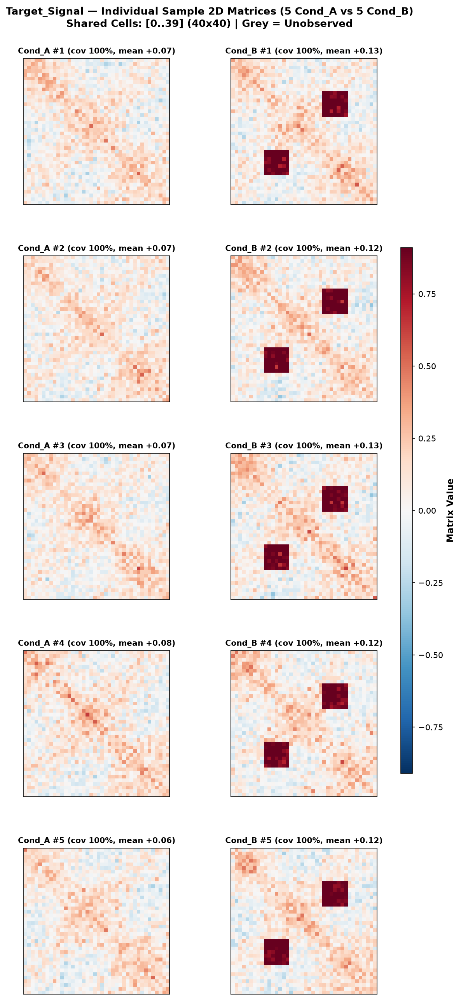
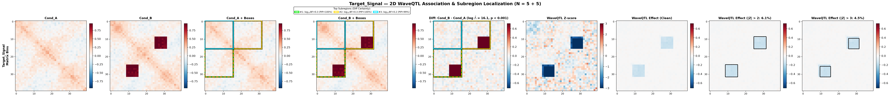

# WaveQTL-2D

Wavelet-based association testing and subregion localization for multi-sample **2D symmetric matrices** across two conditions, extending [WaveQTL (Shim & Stephens, 2015)](https://github.com/heejungshim/WaveQTL).

---

## 1. Installation

### Prerequisites
Requires a C++ compiler (`g++`, `make`) and the GNU Scientific Library (GSL):

```bash
# Ubuntu / Debian / WSL
sudo apt-get update && sudo apt-get install -y build-essential libgsl-dev

# macOS (Homebrew)
brew install gsl
```

### Install Package
Clone the repository, navigate into it, and install:

```bash
git clone https://github.com/Yulin-W/WaveQTL-2D.git
cd WaveQTL-2D
pip install .
```

`pip install .` compiles the C++ `WaveQTL` engine automatically.

!!! note "macOS Linking Note"
    If static linking fails (`-lgsl` / `-lc`), remove `-static` on line 35 of `src/Makefile` before running `pip install .`.

---

## 2. Input Format

Input is a tab-separated table (`.tsv` or `.tsv.gz`) containing upper-triangular or symmetric matrix entries:

| Column | Description | CLI Override |
| :--- | :--- | :--- |
| `target` | Feature/region identifier | `--group-by` |
| `condition` | Condition label (e.g. `Cond_A`, `Cond_B`) | `--cond-col` |
| `sample` | Sample identifier | `--sample-col` |
| `cell_i`, `cell_j` | 2D matrix coordinates (0-indexed) | `--row-col`, `--col-col` |
| `value` | Observed signal / interaction intensity | `--val-col` |

Coordinates are automatically aligned to the shared intersection between conditions and padded to dyadic $2^J \times 2^J$ dimensions (minimum $64 \times 64$).

---

## 3. Quickstart

Run with synthetic toy data:

```bash
# 1. Generate synthetic test data
python examples/generate_toy_data.py --output examples/data/toy_2d_matrices.tsv.gz

# 2. Run WaveQTL-2D (transforms, testing, permutations, and plots)
waveqtl-2d \
  --input examples/data/toy_2d_matrices.tsv.gz \
  --output-dir examples/output \
  --num-perm 1000
```

### Common Options
- `--cond1 / --cond2`: Condition contrast order (`Diff = cond2 - cond1`).
- `--num-perm <int>`: Number of permutations (`0` computes analytical Bayes Factors only).
- `--vmax <float>`: Fix heatmap colour scale to `[-vmax, +vmax]`.
- `--full-matrix-tsv <file>`: Optional condition-level matrix for Columns 1–5 (defaults to sample mean).

---

## 4. Outputs

### A. Sample Matrix Grids (`sample_plots/<target>_samples.png`)
Side-by-side matrices for each individual sample across both conditions (unobserved bins in grey) to inspect sample-to-sample variability.



### B. 9-Column Comparison Figure (`comparison_<target>.png`)
Multiscale wavelet decomposition and localized effect mapping:

- **Cols 1–2**: Reference condition heatmaps.
- **Cols 3–4**: Top-3 localized dyadic subregions ranked by $\log_{10}\text{BF}$.
- **Col 5**: Empirical difference ($\log \hat{\Lambda}$ and permutation $p$-value).
- **Col 6**: Reconstructed data-space $Z$-scores.
- **Cols 7–9**: Shrunk posterior effect estimates with $|Z| > 2$ and $|Z| > 3$ contours.



---

## Citation & License

Distributed under **GPLv3+**. Based on:
- Heejung Shim and Matthew Stephens (2015). *Wavelet-based genetic association analysis of functional phenotypes arising from high-throughput sequencing assays*. Ann. Appl. Stat. 9(2), 665–686.
